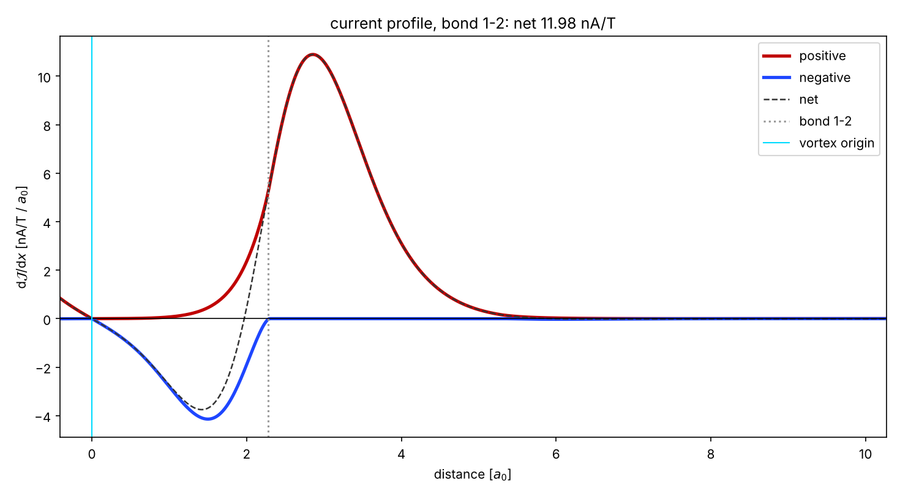
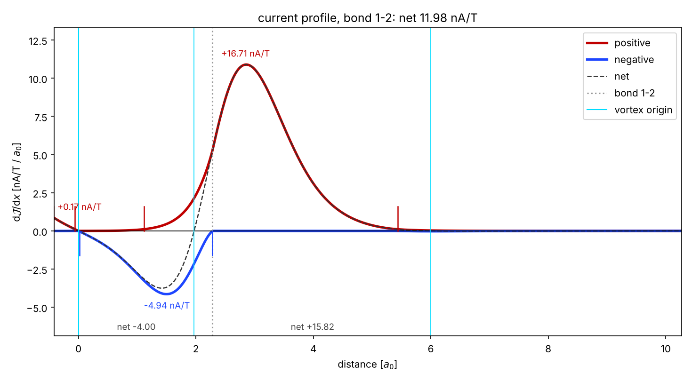
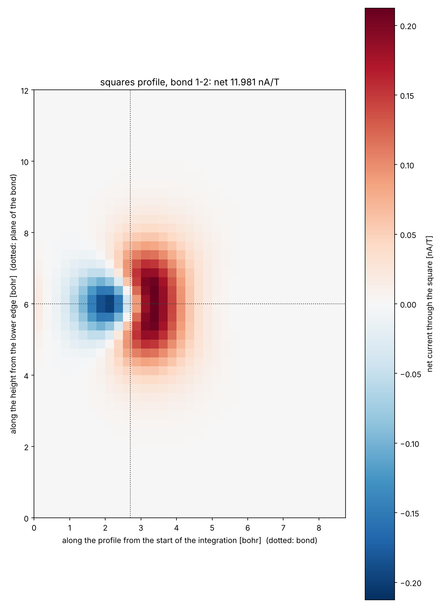
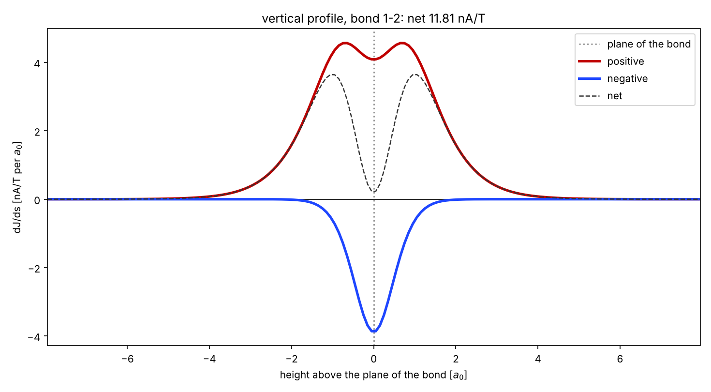

Current profiles: gimic-profile
===============================

Introduction
----------------------------

Current profiles (the current through an integration plane resolved into thin
slices) are set up, run and plotted with the command ``gimic-profile``, which
is installed together with ``gimic``. GIMIC computes all slices of a profile in
one run (keyword ``slice_thickness``, see the grids section), in parallel with
OpenMP over the columns of the integration grid, so a profile is one
calculation on a laptop or one batch job on a cluster.

The command needs ``MOL`` and ``XDENS`` in the working directory (prepared with
``turbo2gimic.py`` or ``Gaussian2gimic.py``). The geometry is taken from the
Turbomole ``coord`` file (bohr) if present, otherwise from ``coord.xyz``
(Ångström) or from the coordinates in ``MOL``, so nothing else has to be
prepared.

Quick summary
-----------------------------

::

   gimic-profile                                   # asks for everything, defaults in brackets
   gimic-profile --bond 4 5 --ring 1 2 3 4 5 6     # asks only what is missing
   gimic-profile --bond 4 5 --ring 1 2 3 4 5 6 --in 2.9 --slice 0.02 --threads 8 --yes
   gimic-profile --mode squares --bond 4 5 --ring 1 2 3 4 5 6 --slice 0.25 --slurm --time 4 --submit
   gimic-profile --rerun current_profile_4.5/profile.json --slice 0.01 --suffix fine
   gimic-profile --plot current_profile_4.5 --zero origin --mark "7 8 9 10 11 12"
   gimic-profile --help

The old script names (``current-profile-local.sh``, ``current-profile-cluster.sh``,
``vertical-profile-*.sh``, ``squares-profile-*.sh``, ``gimic-run.sh``,
``plot-current-profile.sh``, ``crit_pts.sh``) remain as thin wrappers around
``gimic-profile`` with the corresponding options. ``make install`` configures
them, together with ``3D-run.sh``, and installs them next to ``gimic``, so no
separate setup step is needed: with the ``bin`` directory of the installation
on the ``PATH`` they can be called by name, and they find ``gimic-profile``
and ``gimic`` of their own installation even without it.
``jobscripts/setup.sh`` still prepares the same scripts inside the
``jobscripts`` directory for those who prefer to run them from there.

The questions
-----------------------------

Every parameter is an option; whatever is not given is asked for, with the
default shown in brackets, and Enter accepts it. With ``--yes`` nothing is
asked and all defaults are taken. Lengths are in bohr, or in Ångström with
``--angstrom`` (a typed value may also carry a unit: ``2.5 A``, ``1.3 bohr``).

1. **The bond**: the two atoms perpendicular to whose connection line the
   plane lies (``--bond``). The atoms are echoed with their symbols and
   coordinates, so a wrong index is caught at once. Two atoms farther apart
   than 1.25 times the sum of their covalent radii are treated as reference
   points rather than a bond (the plane still passes through the point
   ``--distance`` from the first along their connection line, the midpoint
   by default) and are labelled so. The atoms within 0.6 bohr of the plane
   are listed with their position along the profile and marked in the
   plots: that is what the profile cuts through.
2. **The position of the plane along the bond** (``--distance``), by default
   the midpoint.
3. **The start of the integration**: either the indices of the atoms of the
   ring (``--ring``), whose centroid then is the reference centre, or a
   distance from the bond (``--in``). With a ring, the centroid distance is
   proposed as the start; for a non-symmetric ring increase it a little, so
   that the profile reaches past the vortex origin, which then shows up as the
   first zero crossing of the net current (reported in ``profile_points.dat``
   and usable as the zero of the plot with ``--zero origin``). The reference
   centre fixes the side of the bond on which the integration starts and the
   sign convention (diatropic currents positive), whatever the order of the
   two bond atoms; it does not set where the plane starts or ends.
4. **out, up, down** (``--out``, ``--up``, ``--down``): the end of the
   integration beyond the bond and the extent of the plane along and against
   the field; 8 bohr by default, which is "infinity" for practical purposes.
5. **The slice thickness** (``--slice``): 0.02 bohr by default (0.25 for the
   squares profile). The slices have exactly this thickness; when the width
   (or height) of the plane is not a multiple of it, GIMIC extends ``out``
   (or ``up``) to the next whole slice, and the command says so before
   anything runs, because it moves the edge of the plane.
6. **The grid spacing** along the height (``--spacing``), with a tested
   default derived from the slice thickness.
7. **The magnetic field** (``--field``): ``0 0 -1`` by default, ``ring`` for
   the normal of the plane through the ring atoms, three components, or ``X``
   for ``magnet_axis=X``.

``--mode vertical`` slices the plane along its height instead, ``--mode
squares`` along both axes (a map of the current through rectangles),
``--mode integral`` computes the plane without slices. ``--rotation`` and
``--rotation-origin`` rotate the plane; ``--fixpoint`` or ``--fixcoord``
replace the ring centroid as reference centre.

What happens then
-----------------------------

A directory ``current_profile_4.5`` (``vertical_profile_``,
``squares_profile_``, ``bond_int_``; ``--suffix`` adds a suffix) is created
with ``gimic.inp`` for the whole plane. A dry run prints the number of grid
points and slices, the warnings, the estimated run time on one core and on
the available threads, and the corners of the plane; ``grid.xyz`` in the
directory holds the molecule, the four corners (X) and the field direction
(Be) for inspection, e.g. in VMD (see below). All settings, including the
derived ones, are recorded in ``profile.json``; ``--rerun profile.json``
repeats a run with any option changed, ``--dry-run`` stops after the dry run.

Locally, GIMIC then runs with ``--threads`` OpenMP threads (all cores by
default), the progress is printed, and the results are plotted. With
``--slurm`` a job script ``job.sh`` is written instead, from the ``#SBATCH``
header in ``~/.gimic/jobscript-header`` (copy and edit
``share/gimic/jobscript-header`` of the installation, or give
``--slurm-header``), and submitted with ``--submit``; the job asks for one
task with ``--threads`` cores and ``--time`` hours.

Results
-----------------------------

* ``current_profile.dat``: one line per slice from the start of the
  integration: distance, net, positive and negative current (nA/T). A plane
  cannot tell the tropicity of a current; by the sign convention a diatropic
  ring current comes out positive.
* ``tropicity_profile.dat``, with ``--tropicity`` (``tropicity=on`` in the
  ``Essential`` section of the input): one line per slice with the distance,
  the net current and its diatropic, paratropic and undefined parts (nA/T),
  which add up to the net current. Here the tropicity is assigned by
  following the streamline through every grid point until it has made one
  turn around the field, see the ``tropicity`` keyword in the input
  chapter. A current that circulates locally, around a bond or an atom,
  crosses the plane twice and cancels in these columns, whereas it is
  counted once as positive and once as negative in
  ``current_profile.dat``. The vertical and the squares profile write
  ``tropicity_vertical_profile.dat`` and ``tropicity_squares_profile.dat``.
  ``tropicity_profile.png`` and ``.pdf`` are the plot. The run takes much
  longer, since every grid point costs some hundreds of evaluations of the
  current density, and it is available for closed-shell molecules only.
  The functions ``antropicity`` and ``revtropicity`` in
  ``jobscripts/useful-aliases`` sum the columns between two distances and
  reverse their sign.
* ``profile_points.dat``: maxima and minima of the current per bohr, the
  zero crossings of the net current with the current integrated between
  them, and the blobs of the positive and the negative contribution with
  their boundaries, peaks and integrated currents, i.e. the strength of
  each feature. Also printed at the end of the run.
* ``profile.dat``, ``vertical_profile.dat``, ``squares_profile.dat``: see
  the description of the output files.
* ``profile_plane_1.2.vtp`` and ``profile_line_1.2.vtp`` (named after the
  bond atoms): the plane and the profile for ParaView, to be laid over the current density of a separate 3D
  calculation (``jvec.vti``, see the visualisation chapter). The plane is
  made of one quad per slice (per rectangle for the squares profile) with
  the current through it as cell data (``net``, ``positive``, ``negative``,
  also per area); the line runs along the middle of the plane with the
  current per unit length as point data and carries the sign changes of the
  net current as vertices (``marker`` 1 is the first one, the vortex
  origin). Coordinates in bohr, like ``jvec.vti``. ``paraview_profile_1.2.py``
  assembles them in ParaView (``paraview --script=...``; ``--jvec FILE``
  adds a slice of the current density of a 3D calculation).
* ``current_profile.png`` and ``.pdf`` (``vertical_profile.*``,
  ``squares_profile.*``): the plots, made with matplotlib if it is
  installed. ``current_profile_annotated.*`` adds the strengths of the
  features: for every positive and every negative blob (a range where the
  contribution is above 1% of its largest value) its boundaries are marked
  by short lines at the axis and its integrated current is written at the
  peak; the net current between consecutive zero crossings is written
  along the bottom. With ``--compare``, ``compare_net.*`` shows the net
  currents of the profiles and ``compare_contributions.*`` their positive
  and negative contributions. ``gimic-profile --plot DIR`` plots again: ``--zero origin``
  puts x = 0 at the vortex origin, ``--zero bond`` at the bond,
  ``--mark 7 "9 10 11"`` marks atom 7 and the centroid of atoms 9, 10 and
  11 along the profile (also at run time; the marks are kept in
  ``profile.json``), ``--no-atom-marks`` drops the automatic marks of the
  atoms the plane passes through, ``--compare DIR2 DIR3`` adds the
  comparison figures, ``--yrange`` sets the y range, ``--angstrom`` labels
  in Ångström.

Examples: benzene, bond 1-2, start 0.4 bohr past the ring centre, 0.02 bohr
slices (``--zero origin``); the squares profile with 0.25 bohr squares; and
the vertical profile with 0.1 bohr slices.

Inspecting the plane
-----------------------------

VMD is a highly recommended tool for visualisation of molecules, in
particular the integration planes: open ``grid.xyz`` of the profile
directory. A useful representation of the plane can be done using the procedure below, which has to be placed in the ``~/.vmdrc`` file. It actually draws the integration planes for all the opened molecule in VMD.  

::

   proc intplanes {} {
   
       set loadedMolecules [molinfo list]
   
   	foreach molid $loadedMolecules {

        mol showrep $molid 0 off
        mol modselect 0 $molid "all not element X Be"
        set xel [atomselect $molid "element X"]
        set coords [$xel get index]

        for {set i 0} {$i < 4} {incr i} {
        lassign $coords i1 i2 i3 i4
        }

        set c1 [atomselect $molid "index $i1"]
        set c2 [atomselect $molid "index $i2"]
        set c3 [atomselect $molid "index $i3"]
        set c4 [atomselect $molid "index $i4"]

        lassign [$c1 get {x y z}] pos1
        lassign [$c2 get {x y z}] pos2
        lassign [$c3 get {x y z}] pos3
        lassign [$c4 get {x y z}] pos4

        draw color red
        set LINEWIDTH 6
        draw line $pos1 $pos2 width $LINEWIDTH
        draw line $pos3 $pos4 width $LINEWIDTH
        draw line $pos1 $pos3 width $LINEWIDTH
        draw line $pos2 $pos4 width $LINEWIDTH

        set posHalf1 [ vecscale 0.5 [ vecadd $pos1 $pos2 ] ]
        set posHalf2 [ vecscale 0.5 [ vecadd $pos3 $pos4 ] ]

        set LINEWIDTH 3 
        draw line $posHalf1 $posHalf2 width $LINEWIDTH
        }

        mol representation CPK 0.600000 0.300000 50.000000 50.000000
        mol color Element
        mol material Opaque
        mol addrep $molid
   	mol modselect 1 $molid "all not element X Be"
   }

The magnetic field vector can be drawn using the following VMD procedure:

::

   proc arrow {start ending scaling} {
       set end [ vecscale $scaling $ending]
       set middle [vecadd $start [vecscale 0.8 [vecsub $end $start]]]
       draw cylinder $start $middle radius [ expr 0.08*$scaling]
       draw cone $middle $end radius [ expr 0.15*$scaling ]
   }

Some tips and advice
-----------------------------

**TIP:**  A short way to preview the integration plane without doing the calculations are dry runs:

::

   function dryrun() { gimic --dryrun "$@" > /dev/null ; xmakemol -f grid.xyz;  };

Choosing integration planes can be tricky. One way to get a better feeling for the current densities in a molecule is to start with the 3D calculation of the current density and exploring it in Paraview. You can use the new ``3D-run.sh`` script. It is rather basic at the moment, and the input file needs to be inspected and the grid checked before starting the calculation. Its aim is to create a decently large box around the molecule. For molecules larger than 100 atoms it is reasonable to use spacing of 1 bohr, otherwise the calculation takes too long. In small systems 0.5 bohr is a good choice; less than that might be an overkill, unless one needs close-up views of currents. The calculation can only run in serial. Once the calculation starts, GIMIC gives a good estimate of how long it will take. If it is unreasonable, size of the box or the spacing should be adjusted. The 3D calculation will give the ``jvec.vti`` file. It also prints the ``mol.xyz`` file. Paraview cannot handle XYZ files at the moment, so they need to be converted to CML format first. The bash function below can be used. It employs openbabel. In case openbabel is missing, the ``mol.xyz`` file can be saved as ``mol.cml`` in Avogadro and the first line of the function commented out. 

::

   function molecule() {
   babel -ixyz mol.xyz -ocml mol.cml
   awk '{ {FS="\""}; {OFS="\""};
        if ($1 ~ "<atom id") {
            if ($5 ~ "spinMultiplicity")
                { print $1, $2, $3, $4, $5, $6, $7, $8/0.526, $9, $10/0.526, $11, $12/0.526, $13 }
            else  { print $1, $2, $3, $4, $5, $6/0.526, $7, $8/0.526, $9, $10/0.526, $11 }
            }
        else print $0; }' mol.cml > mol-bohr.cml

   # It takes an XYZ file as an argument:

   $ molecule mol.xyz

The provided Paraview state file ``3D-LIC.pvsm``, it will ask about the location of the ``jvec.vti`` and ``mol-bohr.cml`` files. After they are loaded, it should present the line integral convolution (LIC) representation. In the *Slice* filter changing the z component of the origin permits exploring the current densities vertically. The number of arrows illustrating the current direction is adjusted from the *Glyph* filter. In the *Masking* group the selected Glyph Mode is *Every Nth Point*. Change the stride according to your preference. The length of the arrows is adjusted from the Scaling group, the *Scaling Factor* value. 

The 3D visual inspection help identifying which current vortices are interesting and where the integration plane would cross as few other vortices as possible. 

